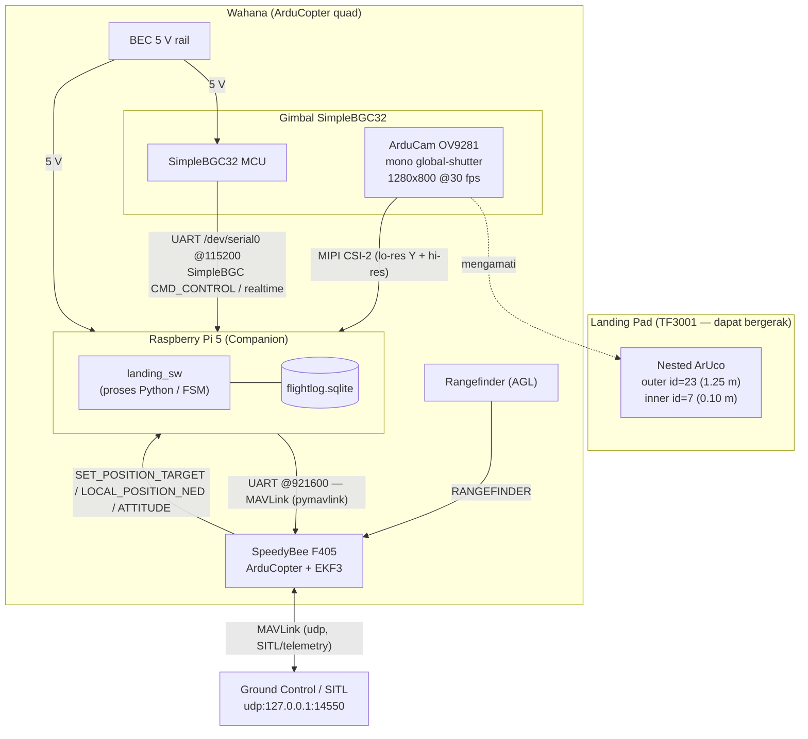
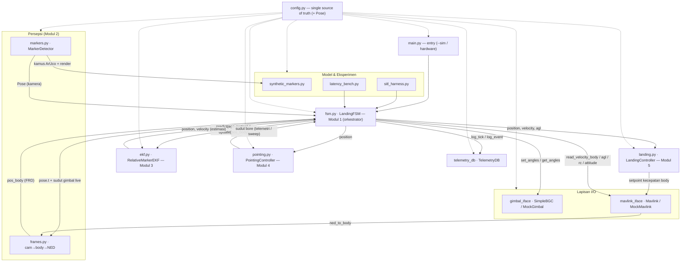
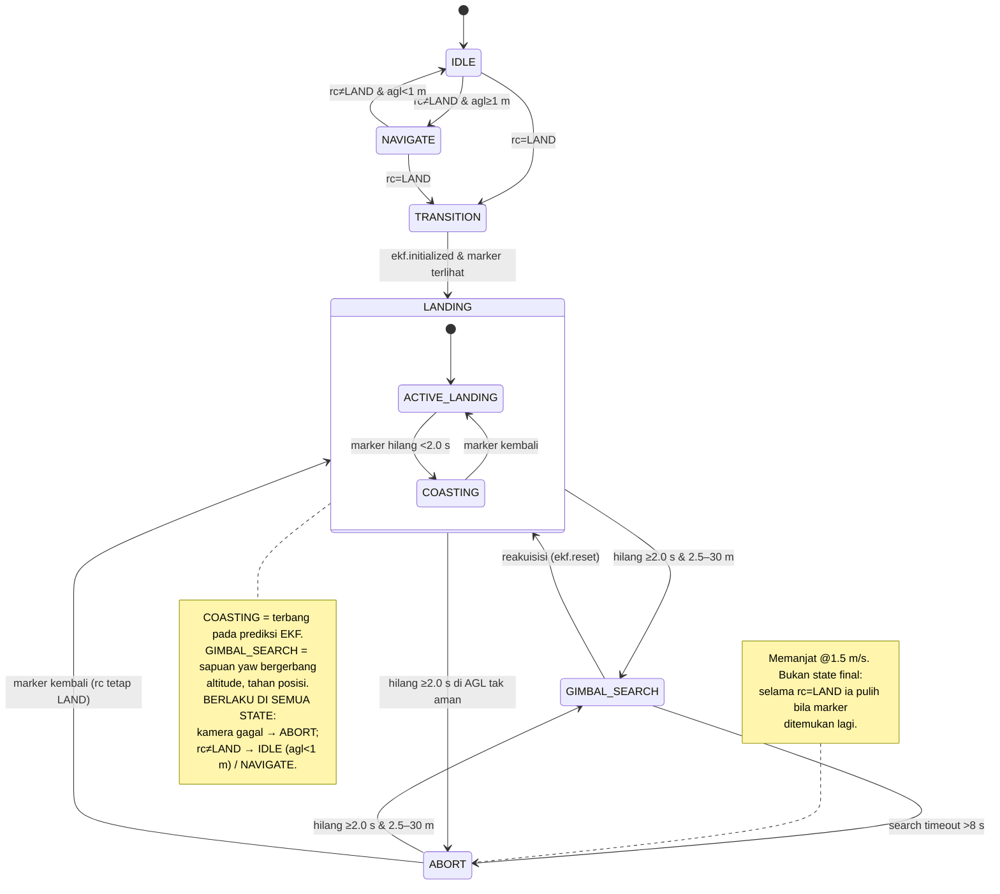
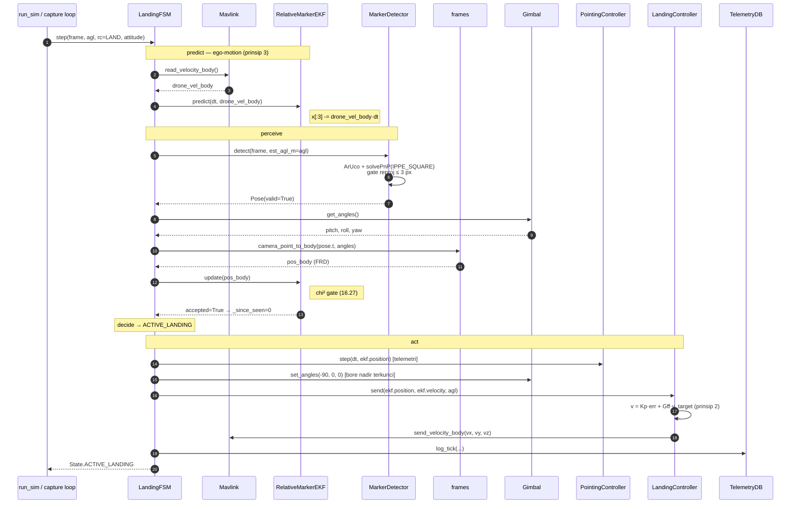
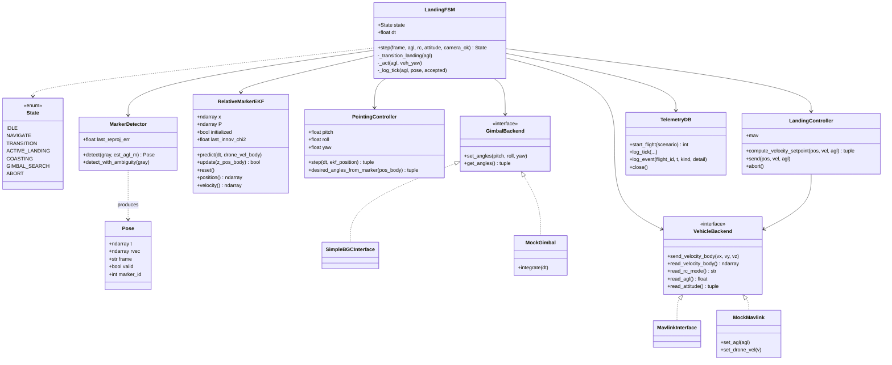
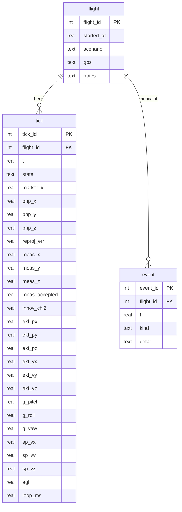

# landing_sw — Diagram Perancangan

Kumpulan diagram Mermaid untuk perangkat lunak companion *vision precision-landing*
(Raspberry Pi 5 + ArduCam OV9281 + SimpleBGC32 + SpeedyBee F405 / ArduCopter).

---

## 1. Deployment Diagram

---

## 2. Software Architecture

Tampilan komponen + aliran data utama. Panah berlabel dengan *apa* yang mengalir;
`LandingFSM` (Modul 1) adalah orkestrator yang membaca estimasi EKF lalu
meneruskannya ke pointing & landing.

---

## 3. Finite-State-Machine Diagram

`ACTIVE_LANDING` dan `COASTING` digabung dalam state majemuk **LANDING**
(COASTING hanya jeda kehilangan marker singkat di dalam pendaratan). Dua
transisi bersifat **global** ke semua state dan ditarik dari catatan, bukan
sebagai panah per-state, agar diagram tetap terbaca.

---

## 4. Sequence Diagram — ACTIVE_LANDING

Satu iterasi `LandingFSM.step()` saat berada di state `ACTIVE_LANDING`
(marker terlihat & diterima EKF).

---

## 5. Class Diagram

---

## 6. Entity Relationship Diagram — Telemetry Data

---

## 7. Berkas Perancangan Rinci

| Berkas | Peran | Ringkasan |
|---|---|---|
| `config.py` | Sumber tunggal | seluruh parameter; nilai bertanda `# MEASURE` diisi dari eksperimen; mendefinisikan `Pose` |
| `markers.py` | Modul 2 | deteksi ArUco bersarang + PnP `IPPE_SQUARE` + gerbang reproyeksi (≤3 px) |
| `frames.py` | Transform | kamera→body→NED memakai sudut gimbal yang di-stream |
| `ekf.py` | Modul 3 | EKF 6-state; ego-motion sebagai input → kecepatan absolut target |
| `pointing.py` | Modul 4 | estimasi EKF → sudut gimbal (atan2), batas laju slew |
| `landing.py` | Modul 5 | setpoint kecepatan MAVLink + feedforward (`v = Kp·err + Gff·v_target`) |
| `fsm.py` | Modul 1 | mesin 7-state; gating altitude; reset EKF saat reakuisisi |
| `gimbal_iface.py` | I/O | SimpleBGC32 (set+stream sudut) + `MockGimbal` (slew lag) |
| `mavlink_iface.py` | I/O | pymavlink (setpoint, RC, AGL, kecepatan body) + `MockMavlink` |
| `telemetry_db.py` | Data | SQLite skema `flight`/`tick`/`event` |
| `synthetic_markers.py` | Model | render ArUco → validasi persepsi vs ground truth |
| `sitl_harness.py` | Model | loop kendali tertutup; demonstrasi manfaat feedforward |
| `latency_bench.py` | Eksperimen | instrumentasi latensi per-tahap & persentil end-to-end |
| `main.py` | Entry point | picamera2 + pymavlink + SimpleBGC ke FSM; flag `--sim` memakai mock |
